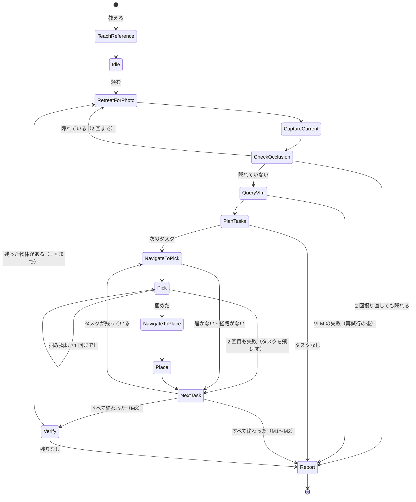

# 設計書

> **ステータス**：確定（2026-10-25。18 章のレビューで、10 問すべて推奨案を採用）。日程（1.3）は仮置き（10/25 の進み具合を見て見直す）
>
> - M1〜M2 に関わる節（2〜9 章）は、読めば実装できる水準で書く。確認とやり直し・評価（10、13 章）は方針と主な決定、「余裕があれば」の機能は数行
> - 各節は「**決定** / **理由** / **根拠** / **未決**」の形で書く。根拠は `docs/experiments/` の検証記録
> - 目次は M0 で作った案に従い、次の 2 点だけ変えた。1.4「設計書の論点への回答」を追加（M0 の論点 1〜10 への答えの対応表を置くため）、18 章「レビューで決めたこと」を追加（決めきれない点を質問として集め、レビューの結果を残すため）

## 目次

1. 概要
2. 全体の流れ
3. システム構成
4. 座標系・単位・データ形式
5. シーン
6. エージェント層（VLM）
7. 知覚
8. 移動層
9. 操作層
10. 確認とやり直し
11. 報告
12. 動画の記録
13. 評価
14. 設定値の管理
15. テスト方針
16. 未解決のリスクと対応
17. 変更履歴
18. レビューで決めたこと

---

## 1. 概要

### 1.1 目的とスコープ

- **決定**：写真 1 枚で教えた「いつもの状態」に、移動マニピュレータ（RidgebackFranka）が部屋を戻すデモを、Isaac Sim 6.1 上で作る。範囲の優先順位は次のとおり

  | 優先度 | 内容 |
  |---|---|
  | 必須 | M1 停止状態でのタスク、M2 移動を含むタスク（物体の位置はシミュレータの真値）、動画、レポート、簡単な定量評価。**台車が物を押し飛ばさないよう、経路計画で家具・物体から距離をとること**は M2 の必須に含める |
  | できれば | 片付け後の確認とやり直し |
  | 余裕があれば | 画像からの位置推定、会議室の場面、遠隔指示の画面、安全性の機能（スタックの検知、人を避けるなど） |

- **理由**：締切（11/2）までの約 3 週間で、合格ラインの動画を確実に作るため
- **根拠**：[M0_summary.md](experiments/M0_summary.md)

### 1.2 用語

| 用語 | 意味 |
|---|---|
| いつもの写真 | 整った状態を天井カメラで撮った RGB＋深度。ロボットは写さない |
| 今の写真 | 片付けを頼まれた時点の天井カメラの RGB＋深度 |
| 戻し先 | いつもの写真での物体の位置（＝物体を置く目標） |
| 撮影位置 | 今の写真を撮るときに台車が止まる位置。ロボットが天板を隠さない（7.2） |
| 作業範囲 | 天板のうち、アームが楽に届く帯（5.2）。物体はこの中にだけ置く |
| タスク | 1 個の物体を「今の位置で掴み、戻し先に置く」こと |
| 真値 | シミュレータから直接得る物体・ロボットの位置 |

### 1.3 前提と制約

- Isaac Sim 6.1（pip 版）、Windows 11、RTX 5070（12GB）。非推奨の API（`extsDeprecated/`）は使わない
- スマート アプリ コントロールはオンのまま（署名のない DLL が阻止されることがある。[8_startup_time.md](experiments/8_startup_time.md)）
- 日程（2026-10-25 に見直し。仮置き）。締切は 11/2 10:00 で、当日はほぼ作業できないので、提出物は 11/1 の夜までに仕上げる

  | Milestone | 期限 | 内容 |
  |---|---|---|
  | 設計 | 10/25（日） | 設計書の確定、日程、Issue の登録（当初 10/14） |
  | M1 | 10/27（火） | 停止状態でのタスク（合格ラインの動画）。**10/25 完了** |
  | M2 | 10/30（金） | 移動を含むタスク（机と低い棚の間を移動して戻す）。**10/25 完了** |
  | M3 | 10/31（土） | 確認とやり直し（#19）、画像からの推定（#23）、箱の向きを戻す（#25）、報告の画面（#24）、定量評価（#18） |
  | M4 | 11/1（日） | 動画の編集・レポート |
  | 提出 | 11/2（月）10:00 | 提出のみ |

  - **2026-10-26 の見直し**：M1・M2 が予定より早く終わったので、保留にしていた「できれば」「余裕があれば」の機能のうち、確認とやり直し・画像からの推定・報告の画面を入れ、箱の向きを戻す機能を加えた（18 章 Q3 の変更）。順番は #19（10/26）→ #23（10/26〜27）→ #25（10/27）→ #24（10/28）→ #18（10/29）→ M4（10/30〜11/1）。オプションの機能を含めた最終の形で評価する
  - **遅れたときに削る順番**：(1) 報告の画面（#24）、(2) 箱の向きを戻す（#25）、(3) 画像からの推定（#23。真値に戻せる）、(4) 評価を 5 エピソードに減らす
  - **判断の時点**：10/29 の夜に #18 に着手できていなければ、残りのオプションを削る

### 1.4 設計書の論点への回答

M0 のまとめの「設計書の論点」1〜10 への答えの場所。

| 論点 | 答え | 節 |
|---|---|---|
| 1. 全体の流れ（単位、失敗時） | 状態機械。1 物体ずつのタスクの列。失敗は 1 回やり直してから飛ばす | 2 |
| 2. 物体と場面 | #9 の自宅風の部屋と物体 5 個。置き場所は天板の作業範囲だけ。会議室は余裕があれば | 5 |
| 3. 知覚の差し替え | `WorldState` のインターフェースで真値と推定を差し替える | 3.3、7 |
| 4. VLM の出力をロボットの目標にする方法 | 名前→物体、戻し先の画素＋いつもの深度→3 次元位置 | 6.3 |
| 5. 移動層 | 止め位置の計算、格子地図と A*、比例制御で追従。家具から距離をとる | 8 |
| 6. 操作層 | PickPlaceController を「掴む」と「置く」に分けて移植。置く向きは変えない | 9 |
| 7. 確かめる・やり直す | 片付けの後にもう一度撮って比べ、残った物体を 1 回だけやり直す | 10 |
| 8. 評価 | 成功率、戻し先からの誤差、所要時間、VLM の費用。シード固定で 10〜20 試行 | 13 |
| 9. 動画 | headless で連番画像を保存し ffmpeg。俯瞰＋追従＋天井 | 12 |
| 10. コードの構成 | `core`（Isaac Sim 非依存）と `sim`。設定値は dataclass。テストは 3 層 | 3.2、14、15 |

---

## 2. 全体の流れ

### 2.1 教える・頼む・見比べる・動く・確かめる・報告する

- **決定**：1 回の実行（エピソード）は次の順に進む。M1 では台車を動かさない（手順 4 の移動を省く）

  1. **教える**：いつもの写真を撮る（ロボットは部屋の外）
  2. **頼む**：物体を 1〜3 個動かした状態から、実行を始める（デモ・評価とも。18 章 Q10）
  3. **見比べる**：撮影位置へ下がって今の写真を撮り、隠れていないことを確かめ（7.2）、VLM で動いた物体と戻し先を得る（6）
  4. **動く**：タスクを 1 個ずつ、掴む場所の正面へ移動 → 掴む → 置く場所の正面へ移動 → 置く（8、9）
  5. **確かめる**：もう一度撮って比べ、残った物体をやり直す（10。できれば）
  6. **報告する**：前後の写真と実行の記録を保存する（11）

  - **運ぶ順番**：今いる位置から近い順（18 章 Q6）。今の台車の位置（2 個目からは、前のタスクで置いたときの止め位置）から、掴む物体までの水平の直線距離が最も短いタスクを次にする（貪欲法）
  - **M1 の範囲**：台車を机の正面の 1 か所に止めたまま、その位置から届く物体だけを片付ける。低い棚の物体は M1 では扱わない（18 章 Q4）

- **理由**：1 物体ずつ運ぶ方が、失敗の影響が小さく、評価もしやすい。近い順は移動が短く、実装も簡単

### 2.2 タスクの状態遷移



- M1 では `NavigateToPick` と `NavigateToPlace` は「何もしない」（台車は最初から机の正面にいる）
- `RetreatForPhoto` は M1 では台車を動かさず、アームを撮影姿勢（9.3。台車の後ろ側へ回した姿勢）にするだけ（#14）。M2 では撮影位置へ下がる

### 2.3 失敗時の扱い

| 失敗 | 対応 | 記録 |
|---|---|---|
| VLM の API エラー・解析の失敗 | 2 回まで再試行。それでも失敗なら実行を終える | エラーの全文 |
| 撮り直しても隠れる | 2 回撮り直したら、その時点の写真で進める（M1〜M2）／終える（評価では失敗） | 隠れた画素数 |
| VLM の名前が物体の一覧にない | その予測を捨てる | 予測の全文 |
| 戻し先が作業範囲の外 | そのタスクを飛ばす | 戻し先の座標 |
| 止め位置が見つからない・経路がない | そのタスクを飛ばす | 理由 |
| 掴み損ね（持ち上がらない） | 掴み直しを 1 回。それでも失敗なら物体をその場に残して飛ばす | 段階・時刻 |
| 運ぶ途中で落とした | 飛ばす（落ちた物体は真値で検出） | 落ちた位置 |
| 動作計画の失敗・時間切れ | 待機姿勢に戻して飛ばす | 段階 |

- **理由**：デモと評価の両方で、1 個の失敗で全体が止まらないようにする

---

## 3. システム構成

### 3.1 階層

- **決定**：判断が必要な部分だけを VLM が担い、実行は古典的な手法で行う（README の構成どおり）

  | 層 | 担当 | 主な手法 |
  |---|---|---|
  | エージェント層 | 何を、どこへ戻すかを決める | VLM（Claude Sonnet 5.5） |
  | 知覚 | 写真、隠れの判定、物体・ロボットの位置 | 天井カメラ（RGB＋深度）、真値 |
  | 移動層 | 物体の正面へ台車を動かす | 格子地図＋A*、速度指令 |
  | 操作層 | 掴んで置く | cuMotion の RMPflow、PickPlaceController の手順 |
  | 全体の制御 | 状態遷移、失敗の扱い、記録 | 状態機械（2.2） |

### 3.2 モジュール構成（`core` と `sim`）

- **決定**

  ```
  src/restorebot/
  ├── core/                 # Isaac Sim を import しない。単体テスト必須
  │   ├── types.py          # Pose2D、ObjectState、Observation など（3.3）
  │   ├── scene.py          # SceneSpec と HOME_V2（部屋・置き場所・物体・いつもの配置・カメラ）
  │   ├── camera.py         # DownCamera（投影・逆投影）
  │   ├── vlm/              # client.py（VlmClient、Claude・Gemini・Dummy、真値の応答）、prompt.py、parse.py、detect.py（問い合わせと再試行。#12）
  │   ├── grasp.py          # 掴む・置くの段階の列と進める判定、手先の向きの選び方（#13）
  │   ├── report.py         # エピソードの記録と保存（11 章。#14）
  │   ├── tasks.py          # VLM の応答 → タスクの列（6.3）
  │   ├── occlusion.py      # 撮影位置の計算、深度による隠れの判定（7.2）
  │   ├── navigation.py     # 格子地図、A*、止め位置、経路追従の速度指令（8）
  │   ├── episode.py        # 状態機械（2.2）。Protocol 越しに sim を呼ぶ
  │   ├── evaluation.py     # 成功の判定と集計（13）
  │   ├── video.py          # ffmpeg のコマンド（12）
  │   └── config.py         # 設定値（14）
  └── sim/                  # Isaac Sim に依存する部分
      ├── app.py            # SimulationApp の起動（headless が既定）
      ├── scene_builder.py  # SceneSpec からシーンを作る（家具・物体・ロボット・カメラ）
      ├── world.py          # WorldState（真値）、天井カメラ
      ├── base.py           # 台車の速度指令（BaseDriver）
      ├── arm.py            # cuMotion（#3 の ArmPlanning の移植）
      ├── manipulation.py   # 掴む・置く（PickPlaceController の分割移植）
      ├── robot.py          # RidgebackFranka の定数と USD の探索（#13）
      ├── robot_adapter.py  # Robot の Protocol の実装（掴んだ物体の記憶、撮影姿勢への移動。#14）
      └── recorder.py       # 撮影用のカメラと連番画像
  scripts/run_episode.py    # 1 エピソードを実行（--milestone m1|m2、--seed、--record）
  scripts/run_eval.py       # 評価（複数シードの実行と集計）
  ```

- **理由**：CLAUDE.md のルール（Isaac Sim 依存の分離）。M0 の検証コード（`scripts/experiments/`）は、設計に合わせて書き直して移す
- **根拠**：`scripts/experiments/vlm_common.py`（#5・#9・#10）、`ridgeback_common.py`（#2）、`arm_sim.py`（#3）、`grasp_place.py`（#4）、`video_*.py`（#6）

### 3.3 データの流れとインターフェース

- **決定**：モジュール間は次の dataclass と Protocol でつなぐ。`core/episode.py` は Protocol だけを使い、`sim` の実装を差し込む（単体テストではダミーを差し込む）

```python
# core/types.py
from dataclasses import dataclass, field
from enum import Enum
from typing import Protocol
import numpy as np


@dataclass(frozen=True)
class Pose2D:
    """台車の姿勢（ワールド座標）。x, y [m]、yaw [rad]。台車の仮想関節の値と同じ。"""

    x: float
    y: float
    yaw: float


@dataclass(frozen=True)
class ObjectState:
    """物体の状態（ワールド座標）。中心の位置 [m] と z 軸まわりの向き yaw [rad]。"""

    key: str  # "cup" など（SceneSpec の ObjectSpec.key）
    position: tuple[float, float, float]
    yaw: float
    surface: str | None  # 置かれている面（"desk" など）。床・不明なら None


@dataclass(frozen=True)
class Observation:
    """天井カメラの 1 枚。rgb: (H, W, 3) uint8、depth: (H, W) float32 [m]（distance_to_image_plane）。"""

    rgb: np.ndarray
    depth: np.ndarray
    time_s: float


@dataclass(frozen=True)
class MoveInstruction:
    """VLM の応答を、物体と 3 次元の目標に直したもの（6.3）。"""

    key: str
    current_px: tuple[float, float]
    target_px: tuple[float, float]
    target_position: tuple[float, float, float]  # 戻し先（物体の中心）[m]
    target_surface: str


@dataclass(frozen=True)
class TidyTask:
    key: str
    pick: ObjectState  # 掴む物体（M1〜M2 は真値）
    place_position: tuple[float, float, float]
    place_yaw: float  # 置いたときの物体の向き。掴んだときの物体の向きのまま（物体の向きは戻さない。18 章 Q3）。手先の向きは sim の掴む処理が決める（#12）
    place_surface: str


class Status(Enum):
    RUNNING = "running"
    SUCCEEDED = "succeeded"
    FAILED = "failed"


@dataclass
class StepResult:
    status: Status
    reason: str | None = None  # 失敗の理由（記録用）


# ---- sim が実装する Protocol ----
class WorldState(Protocol):
    """物体・ロボットの位置。M1〜M2 は真値、推定（余裕があれば）は同じインターフェースで差し替える。"""

    def object_state(self, key: str) -> ObjectState: ...
    def robot_pose(self) -> Pose2D: ...


class CeilingCamera(Protocol):
    def capture(self) -> Observation: ...  # 描画が落ち着くまで進めてから撮る（5.4）


class Action(Protocol):
    """時間のかかる動作（移動・掴む・置く・姿勢の変更）。全体の制御が物理の 1 ステップごとに step() を呼ぶ。"""

    name: str

    def start(self) -> None: ...
    def step(self, dt: float) -> StepResult: ...


class Robot(Protocol):
    def navigate(self, path: list[Pose2D]) -> Action: ...  # 経路に沿って台車を動かす（8.3）
    def pick(self, obj: ObjectState) -> Action: ...  # 9.2
    def place(self, position: tuple[float, float, float], yaw: float) -> Action: ...
    def arm_to(self, posture: str) -> Action: ...  # "standby" | "folded"（9.3）
    def holding(self) -> str | None: ...  # 掴んでいる物体（真値で判定）


class Simulation(Protocol):
    def step(self) -> float: ...  # 物理を 1 ステップ進め、経過時間 [s] を返す
```

- 全体の制御（`core/episode.py`）の骨格

```python
@dataclass
class EpisodeConfig:
    milestone: str  # "m1" | "m2"
    max_retakes: int = 2
    max_grasp_retries: int = 1
    verify: bool = False  # M3 で True


class Episode:
    def __init__(
        self,
        scene: SceneSpec,
        world: WorldState,
        camera: CeilingCamera,
        robot: Robot,
        vlm: VlmClient,
        sim: Simulation,
        config: EpisodeConfig,
        log: EpisodeLog,
    ): ...
    def teach(self) -> None: ...  # いつもの写真を撮って保存する
    def run(self) -> EpisodeLog: ...  # 2.2 の状態遷移を最後まで進める
```

- **理由**：動作を `Action` にして「1 ステップずつ進める」形にすると、物理の制御ループ・撮影・動画の記録を 1 つのループで回せる（#6：Movie Capture のようにタイムラインを外から動かす仕組みとは組み合わせない）
- **根拠**：[6_video.md](experiments/6_video.md)、[4_grasp_place.md](experiments/4_grasp_place.md)（PickPlaceController も 1 ステップずつ呼ぶ形）

### 3.4 実行の仕組み

- **決定**
  - 物理は 60Hz。全体の制御のループで、1 ステップごとに今の `Action.step()` を呼び、`simulation_app.update()` を 1 回進める
  - VLM の問い合わせ（約 3 秒）はループを止めて待つ（シミュレータの時刻は進まない。動画にも空白は入らない）
  - headless が既定。GUI はオプション（`--gui`）

---

## 4. 座標系・単位・データ形式

- **決定**
  - 単位は SI（m、rad、s）。ワールド座標は Z 軸が上
  - 台車の姿勢 `Pose2D` は台車の仮想関節の値と同じ（x・y・yaw の関節はワールド基準）
  - クォータニオンは Isaac Sim の並び (w, x, y, z) を使い、変数名・型に `_wxyz` を付ける。SciPy（x, y, z, w）との変換は境界の関数（`core/types.py`）だけで行う
  - 画像の座標は左上が原点、u（x）が右、v（y）が下 [px]。天井カメラは真下向きで、画像の右がワールドの +x、上が +y
  - 深度は `distance_to_image_plane` [m]（カメラの光軸方向の距離）
  - VLM の座標はクライアントの境界でピクセル (u, v) にそろえる（Claude はピクセル、Gemini は [y, x] 0〜1000）
- **根拠**：[2_ridgeback_base.md](experiments/2_ridgeback_base.md)（関節＝ワールド姿勢）、[5_vlm_diff.md](experiments/5_vlm_diff.md)（画像の向き、座標の形式）

---

## 5. シーン

### 5.1 部屋のレイアウト

- **決定**：#9 の自宅風の部屋（`HOME_V2`）

  | 項目 | 値 |
  |---|---|
  | 床 | 4.0 × 3.0m（x：-2.0〜2.0、y：-1.5〜1.5）、壁の高さ 2.4m |
  | 机 | 中心 (0.8, 0.85)、1.2 × 0.6m、天板 0.70m（北の壁際） |
  | 低い棚 | 中心 (-1.5, -0.3)、0.4 × 0.8m、天板 0.45m（西の壁際） |
  | 照明 | ドームライトのみ（強さ 1000） |

- **理由**：台車が家具の正面に回り込める広さ。天板の高さは #3 の楽に届く範囲（手先の高さ 0.4〜0.9m）に収まる
- **根拠**：[9_scene_objects.md](experiments/9_scene_objects.md)
- 机の奥（手前の縁から 28cm より奥）にはアームが届かないので、物体は作業範囲（5.2）の中にだけ置く。机の大きさと位置は変えない（18 章 Q1）
- 会議室の場面は余裕があれば（`SceneSpec` を追加するだけで作れる形にしておく）

### 5.2 片付けの対象物と置き場所

- **決定**
  - 物体は #9 の 5 個（赤いコップ、青いペン立て、緑のスプレー缶、黒いリモコン 15 × 4.5 × 4cm、黄色い小箱）。上から掴む。掴む幅 4〜5cm、高さ 4〜10cm、0.5kg 以下
  - 置き場所は家具の天板だけ（床には置かない）
  - **作業範囲**：天板のうち、台車を家具の正面に止めたときにアームが楽に届く帯。台車の前面と家具の隙間 10cm、楽に届く距離 0.55〜0.85m（台車の中心から）なので、**家具の手前の縁から 28cm 以内**（縁の余白 2cm を除く）。物体のいつもの位置も、散らかした位置も、この中に置く
  - **いつもの配置**：#9 の配置のうち、机の 3 個を作業範囲の中へ移す（18 章 Q1）。机の 3 個は、M1 の止め位置（台車の中心 (0.75, -0.02)、机の方を向く）から楽に届く範囲（0.55〜0.85m、正面 ±30°）にも入れる。下の座標は目安で、M1 の最初の Issue で `SceneSpec` に決める

    | 物体 | #9 の位置 | 新しい位置（目安） | 机の縁から | M1 の止め位置からの距離・角度 |
    |---|---|---|---|---|
    | 赤いコップ | (0.40, 0.95) | (0.45, 0.72) | 17cm | 0.80m・22° |
    | 青いペン立て | (0.70, 1.00) | (0.75, 0.75) | 20cm | 0.77m・0° |
    | 黒いリモコン | (1.05, 0.80) | (1.05, 0.72) | 17cm | 0.80m・22° |
    | 緑のスプレー缶 | 低い棚 (-1.5, -0.10) | 変えない | 東の縁から 20cm | （M2） |
    | 黄色い小箱 | 低い棚 (-1.5, -0.50) | 変えない | 東の縁から 20cm | （M2） |

  - **散らかし方**：散らかした位置も作業範囲の中に限る。M1 のシナリオでは、M1 の止め位置から楽に届く範囲に限る。**戻し先がふさがらないよう、散らかした位置は、どの物体のいつもの位置からも、外接円どうしの隙間を 5cm 以上あける**（物体どうしの間隔も同じ）。5cm は、全開の指の外側が物体の縁から出る量（約 3.5cm の見込み）に配置の誤差（約 1cm）を足した値。10cm では、M1 の止め位置から届く机の範囲にリモコンの動かす先がなかった（#11）。動かす先が見つからなければ、動かす物体の選び直しからやり直す。戻し先がふさがった場合の扱い（ほかの物体をいったんよける、など）は #22
- **理由**：#3 の楽に届く範囲と #4・#9 の把持の結果。机の見た目を変えずに済む（机の奥は空く）
- **根拠**：[3_arm_motion.md](experiments/3_arm_motion.md)（届く範囲の表）、[9_scene_objects.md](experiments/9_scene_objects.md)

### 5.3 ロボット

- **決定**：Multiphysics 版の RidgebackFranka（`Robots_Multiphysics/Clearpath/RidgebackFranka/ridgeback_franka.usda`）。シーンの読み込み時に次の物理の設定を変える（`sim/scene_builder.py`）

  | 設定 | 値 | 理由・根拠 |
  |---|---|---|
  | 台車の x・y 関節の `physxJoint:jointFriction` | 0（物理の開始前） | アセットのままでは速度指令が 8〜20cm 手前で止まる（#2） |
  | 指（`panda_finger_joint1/2`）のドライブ | 剛性 2000・減衰 100・最大力 40N | アセットのままでは掴めない（#4）。現実的な値かは未決（16 章） |
  | 台車の外形（計算用） | 前後 ±0.47m、左右 ±0.40m | #2・#10 の実測 |

- **根拠**：[2_ridgeback_base.md](experiments/2_ridgeback_base.md)、[4_grasp_place.md](experiments/4_grasp_place.md)、[10_occlusion.md](experiments/10_occlusion.md)

### 5.4 カメラ

- **決定**

  | カメラ | 位置・向き | 解像度 | 用途 |
  |---|---|---|---|
  | 天井カメラ | 天井の中央、高さ 2.6m、真下向き（回転なし）。焦点距離 12mm／水平アパーチャ 20.955mm（水平画角 82°） | 1280 × 960、RGB＋深度 | いつもの写真・今の写真 |
  | 撮影用（俯瞰・追従） | 12 章 | 1280 × 720、RGB | 動画 |

  - 物体を瞬間的に動かした直後（シナリオの準備）は、150 フレーム進めてから撮る（RTX の残像）
- **根拠**：[5_vlm_diff.md](experiments/5_vlm_diff.md)、[9_scene_objects.md](experiments/9_scene_objects.md)

### 5.5 物理の設定（家具・物体）

- **決定**：家具は衝突ありの固定物（剛体なし）。物体は剛体（質量は 5.2 の値、摩擦 0.8 / 0.6）。物理 60Hz
- **理由**：#4 の把持の条件と同じにする
- 低い棚（天板 0.45m）でも、机と同じ方法・パラメータ・隙間（10cm）で掴んで置ける（#15：5 個 × 3 か所で 15/15、誤差 0.7〜5.0mm）
- **根拠**：[15_shelf_carry.md](experiments/15_shelf_carry.md)

### 5.6 場面の定義

- **決定**：部屋・置き場所・物体・いつもの配置・天井カメラは `SceneSpec`（`core/scene.py`）1 か所にまとめ、画像の生成・VLM・移動・評価で同じ定義を使う。散らかし方（シード固定）も `core/scene.py` に置く（#9 の `generate_scenarios` を作業範囲に合わせて直す）
- **根拠**：[9_scene_objects.md](experiments/9_scene_objects.md)

---

## 6. エージェント層（VLM）

### 6.1 VLM の選定と呼び出し方

- **決定**
  - Claude Sonnet 5.5（`claude-sonnet-5-5`、`effort=high`、構造化出力）。代わりの候補は Gemini Robotics-ER 2（同じ `VlmClient` で切り替え）
  - `VlmClient.detect(before_png, after_png, prompt) -> VlmResult`（#5 のまま）。API キーは `.env`。`anthropic` は 0.x に留める
  - タイムアウト 60 秒、API エラーは 2 回まで再試行
- **理由**：#5 で精度は Gemini と同じ、応答は 2.5〜3 倍速い（約 3 秒、1 回 $0.01）
- **根拠**：[5_vlm_diff.md](experiments/5_vlm_diff.md)

### 6.2 プロンプトと応答の形式

- **決定**
  - プロンプトは #5 の `build_prompt`（英語の指示、物体名のリストを渡す、座標はピクセル）。ロボットの注意書きと `hidden_objects` は加えない
  - 応答の形式は `moved_objects`（name、current_location、current_point、target_location、target_point）
  - 受け取った後に、**今の位置と戻し先が 15px 未満の予測を除く**（`drop_static_predictions`）
- **理由**：#10 で、ロボットが写った画像の誤検出 11 件はすべて「今の位置≒戻し先」で、この処理で全件除けた。`hidden_objects` は一度も使われなかった
- **根拠**：[5_vlm_diff.md](experiments/5_vlm_diff.md)、[10_occlusion.md](experiments/10_occlusion.md)

### 6.3 応答からロボットの目標への変換

- **決定**（`core/tasks.py`）

```python
def to_instructions(
    preds: list[PredictedMove], scene: SceneSpec, reference: Observation, camera: DownCamera
) -> tuple[list[MoveInstruction], list[str]]:
    """VLM の予測 → 目標。2 つ目の戻り値は捨てた予測の理由（記録用）。"""


def plan_tasks(
    instructions: list[MoveInstruction], world: WorldState, scene: SceneSpec, start: Pose2D
) -> list[TidyTask]:
    """掴む物体の状態（真値）を加え、今いる位置から近い順に並べる（2.1）。"""
```

  1. **名前 → 物体**：物体名のリストの完全一致（空白・全角半角・大文字小文字は無視）。一致しなければ捨てる
  2. **戻し先の 3 次元位置**：VLM の戻し先の画素は、物体の中心（高さの半分）を投影した点に当たる（#9 の正解の画素はこの点で、VLM の点との差は 0.4〜1.0px。#12）。まず戻し先の画素を、いつもの写真の深度（5 × 5px の中央値）で逆投影し、その (x, y) がどの天板の上かを判定する。次に、物体の中心の高さ（天板の高さ＋物体の高さ / 2）で逆投影し直して戻し先とする。深度は天板を決めるためだけに使う（画素が物体の上面・側面・天板のどれに当たっても同じ結果になる）。どの天板にも乗らない、作業範囲の外なら捨てる
     - #12 の当初の実装（深度で直接逆投影し、上面の中心とみなす）では、実際の Claude の応答で誤差が 1.5〜1.8cm 出た。物体の中心の高さで逆投影し直すと解消する
  3. **掴む物体の状態**：M1〜M2 は真値（`WorldState.object_state`）。VLM の「今の位置」は使わない（記録のみ）
  4. **置く向き**：物体の向きは戻さない。掴んだときの手先の向きのまま置き、位置だけ戻す（`TidyTask.place_yaw` ＝ 掴んだときの物体の向き。手先の向きは物体の形に合わせて 9.2 の掴む処理が決める。18 章 Q3、#12）
- **理由**：戻し先の画素の誤差は約 1px（机の上で約 3mm。#9）で、逆投影で十分な精度になる。真値の戻し先（いつもの配置）を使うより、実機に近い流れになる（18 章 Q2）。向きを戻すには、置く前に手先を回す処理と、向きの評価が要るので、M1〜M2 では扱わない
- **根拠**：[9_scene_objects.md](experiments/9_scene_objects.md)（戻し先の誤差 0.6〜0.7px）、[5_vlm_diff.md](experiments/5_vlm_diff.md)（深度の確認：誤差 0.000m）

---

## 7. 知覚

### 7.1 真値を使う段階（M1〜M2）

- **決定**：`sim/world.py` の `WorldState` が、物体の剛体の位置・向きと、台車の関節の値をそのまま返す。評価（13 章）も同じ真値で判定する
- **理由**：README のロードマップどおり（M1〜M2 は真値）

### 7.2 写真の撮り方と隠れの判定

- **決定**（`core/occlusion.py`）
  1. **撮影位置**：今いる位置で、アームを撮影姿勢（9.3）にして撮る。隠れの判定（下の 2）で撮り直しになったら、向きを変えずに 20cm まっすぐ下がって撮り直す（`core/navigation.py` の `retreat_pose`。下がった位置で家具・壁から 5cm 以上離れていなければ下がらない）。M1（#14）では、撮影姿勢なら止め位置のままで天板を隠さなかった
     - #10 の「ロボットを箱とみなして天井カメラに投影し、天板に重ならない位置を探す」（`choose_shoot_pose`）は使わない。撮影姿勢のアームは単純な箱にならない（上腕は台車の前方右へ伸び、手先が後ろに来る）ので、形を仮定せず、実際の深度で判定する（#16）
  2. **隠れの判定**：今の深度が、いつもの写真の深度より 15cm 以上近い画素をロボットの領域とし、天板の物体を置ける範囲（縁から 4cm 内側）にかかれば撮り直す（2 回まで）
- **理由**：#10 で、撮影位置では 20 組すべてで物体が隠れず、判定は 50 組で見逃し 0・撮影位置での不要な撮り直し 0
- **根拠**：[10_occlusion.md](experiments/10_occlusion.md)

```python
def retreat_pose(current: Pose2D, distance: float, scene: SceneSpec) -> Pose2D | None: ...  # core/navigation.py
def robot_mask(current_depth: np.ndarray, reference_depth: np.ndarray, margin: float = 0.15) -> np.ndarray: ...
def needs_retake(mask: np.ndarray, scene: SceneSpec, camera: DownCamera, inset: float = 0.04) -> bool: ...
```

### 7.3 画像からの推定（余裕があれば）

- 方針：`WorldState` の別の実装として、VLM の「今の位置」の画素と今の深度から物体の位置を逆投影し、向きは物体の上面の形（箱）から推定する。掴む直前に、#4 の許容量（±3cm）に入るかを確かめる

---

## 8. 移動層

### 8.1 止め位置の計算

- **決定**（`core/navigation.py`）：物体（掴む位置・置く位置）ごとに、台車の止め位置を次のように決める
  1. 物体が乗っている家具の 4 辺のうち、台車が部屋に収まり、ほかの家具と重ならない辺を候補にする
  2. 台車は家具の方を向き、前面と家具の縁の隙間を 10cm にする（家具の縁から台車の中心まで 0.57m）
  3. 台車の横方向の位置を物体にそろえる（物体が台車の正面に来る）
  4. 物体が「台車の中心から 0.55〜0.85m、正面から ±30° 以内」に入る候補のうち、今の位置から最も近いもの。なければ「届かない」（2.3）

```python
def approach_pose(target_xy: tuple[float, float], surface: str, scene: SceneSpec, start: Pose2D) -> Pose2D | None: ...
```

- **理由**：#3 の楽に届く範囲（正面 ±30°、0.55〜0.85m）と、机を台車の前面の近く（10cm）まで寄せる条件。#9・#10 のロボットの置き方（`sample_robot_poses`）と同じ考え方
- **根拠**：[3_arm_motion.md](experiments/3_arm_motion.md)
- 壁・ほかの家具に当たる、または物体が届かないときは、横方向の位置を 5cm ずつずらす（最大 ±40cm）（#16）。机の物体は、正面（-y 側）だけでなく左側（-x 側）からも掴める。低い棚は東側（+x）だけ
- 物体が正面からずれていても、楽に届く範囲（正面から ±30°）の中なら掴める（#13：作業範囲の左右の端、正面から約 29° で確認）

### 8.2 経路計画

- **決定**
  - **地図**：`SceneSpec` から作る 2 次元の格子地図（5cm）。障害物は壁と家具の外形
  - **膨張**：障害物を「台車の外接円の半径 0.62m ＋余白 0.10m」だけ膨らませ、台車の中心がその外側を通るように計画する（台車の向きによらず家具・壁に当たらない）
  - **探索**：8 近傍の A*。得られた経路は、見通しの効く点を飛ばして間引く
  - **出発の下がりと最後の寄せ**：止め位置は家具に近い（隙間 10cm）ので、膨張の内側にある。出発するときは、向きを変えずにまっすぐ下がって膨張の外に出る。到着するときは、止め位置から家具と反対向きに下がって膨張の外に出た「寄せの開始点」までを A* で計画し、そこで向きを止め位置の向きにそろえてから、まっすぐ寄せる。下がる・寄せる区間は、台車の外形（向き付きの長方形）と家具・壁の距離が 5cm 以上あることを確かめる（下がる距離は最大 0.6m。`plan_route`、#16）
    - 膨張の外に出る方向は、後ろ → 斜め後ろ（左・右 45°）→ 前 → 左 → 右の順に試す（#17）。机の右端の物体を掴んだ止め位置は東の壁の膨張にも入っていて、まっすぐ下がっても出られなかった（斜め後ろなら出られる）。撮影で下がった後に壁を背にしているときは前に出る
  - A* の区間の経由点の向きは到着時の向き。膨張の外なので、移動しながら回っても家具・壁に当たらない
  - 膨張が大きい（0.72m）ので、台車の中心が通れるのは机の南側と、机と低い棚の間の帯だけだが、机 ⇔ 低い棚の経路は作れる（`outputs/m2_16/routes.png`）
  - **物体からの距離**：物体は天板の上にしかない（床に置かない。5.2）ので、家具から距離をとれば物体を押さない。物体を持って運ぶ間も同じ
- **理由**：M2 の必須条件「家具・物体から距離をとる」を、簡単な方法で満たす。部屋は広く家具は 2 つなので、向きまで考えた探索（SE(2)）は要らない。Isaac Sim のナビゲーションの機能は未調査で、調べる時間がない（18 章 Q5）
- **根拠**：[2_ridgeback_base.md](experiments/2_ridgeback_base.md)（台車は動かせる物を最大 500〜1000N で押す）

```python
@dataclass(frozen=True)
class GridMap:
    resolution: float  # [m]
    origin: tuple[float, float]  # 格子 (0, 0) のワールド座標
    occupied: np.ndarray  # (rows, cols) bool。膨張後


def build_grid(scene: SceneSpec, inflation: float, resolution: float = 0.05) -> GridMap: ...
def plan_path(grid: GridMap, start: Pose2D, goal: Pose2D) -> list[Pose2D] | None: ...
```

### 8.3 経路追従

- **決定**：台車は速度指令（ワールド基準の vx, vy, wz を仮想関節に与える）。経由点に向かう比例制御＋飽和（#2 の `velocity_command`：ゲイン 2.0、上限 0.5m/s・1.0rad/s）。経由点に 5cm 以内・向き 0.1rad 以内で次へ進み（向きもそろえてから進むので、寄せの開始点で向きがそろってから家具に寄せる。#16）、最後は位置 1cm・向き 1° 以内で止まる。台車は全方向に動けるので、移動しながら経由点の向きへ回る
- **根拠**：[2_ridgeback_base.md](experiments/2_ridgeback_base.md)（行き過ぎ 0.5cm、最終誤差 0.1mm）、[6_video.md](experiments/6_video.md)（経由点の切り替え）

```python
class PathFollower:
    def __init__(
        self,
        path: list[Pose2D],
        v_max: float = 0.5,
        w_max: float = 1.0,
        k_lin: float = 2.0,
        k_ang: float = 2.0,
        waypoint_tol: float = 0.05,
        goal_tol: tuple[float, float] = (0.01, 0.017),
    ): ...
    def command(self, pose: Pose2D) -> tuple[float, float, float] | None:
        """今の姿勢 → 速度指令 (vx, vy, wz)。到着したら None。"""
```

### 8.4 撮影位置への移動

- **決定**：撮り直しのときは、`retreat_pose` の位置へ 8.3 の経路追従でまっすぐ下がる（20cm ずつ、最大 2 回）（#16）

### 8.5 スタックの検知（余裕があれば）

- 方針：追従の誤差が 2 秒以上減らない、または指令速度に対して実際の速度が 20% 未満なら止まり、タスクを飛ばす
- 実装（#17、簡単な版）：`sim/base.py` の `NavigateAction` は、台車が 3 秒のあいだ 1cm・0.02rad 以上動かなければ止まって失敗にする。全体の制御はそのタスクを飛ばす（2.3）

---

## 9. 操作層

### 9.1 動作計画（cuMotion）

- **決定**：cuMotion の RmpFlowController（Motion Generation の枠組み）。#3 の `ArmPlanning` の 4 つの処理を `sim/arm.py` に移植する：`panda_link0` の姿勢を根元として渡す、全 DOF の名前で対応させる、tool frame に `panda_hand` を明示する、台車本体を障害物に加える。**台車が動いたら必ず `sync()`**
- **根拠**：[3_arm_motion.md](experiments/3_arm_motion.md)
- **未決**：込み入った場面で RMPflow が局所解に陥ったら TrajectoryOptimizer に替える（今の部屋では起きにくい）

### 9.2 把持と配置

- **決定**：6.1 の `PickPlaceController`（8 段階）を、「掴む」と「置く」の 2 つの `Action` に分けて移植する（`sim/manipulation.py`）

  | Action | 段階 |
  |---|---|
  | `pick` | 真上へ移動 → 下降 → 閉じる → 持ち上げる → 運搬の姿勢へ |
  | `place` | 置く位置の真上へ移動 → 下降 → 開く（0.5 秒以上待つ）→ 3cm だけ真上へ → 退避 → 待機の姿勢へ |

  - パラメータは #4 のまま：`approach_height = lift_height = 0.15m`、`controller_to_grasp_position = (0, 0, 0.1034)`、手先は真下。掴む物体は下降を始めてから、置いて退避するまで cuMotion の障害物から外す
  - 段階の列と、段階を進める判定（PickPlaceController の移植）は `core/grasp.py`、アームと指の制御は `sim/manipulation.py`（#13）
  - 開いた後に待ち、少しだけ上げてから退避するのは、指を開いてすぐ 15cm を一気に上げると、指にもたれたペン立て（細くて背が高い）が引っかかって倒れたため（#13）
  - 物を持って動く段階（持ち上げる・待機姿勢へ・置く位置の真上へ・下降）は、手先の目標を 0.3m/s で少しずつ動かして速さを抑える。RMPflow に最終の目標をそのまま渡すと速く振り、指の腹と線で接するだけの円柱（ペン立て）が手の中で振れて抜けた（#13）
  - **手先の向き**（`core/grasp.py` の `choose_grasp_yaw`。#13）
    - 基準は、台車から物体を見た方向（台車の向きではない。台車の向きを基準にすると、作業範囲の左右の端で手首が回りきらない・置いた後にペン立てが倒れる、が起きた）
    - 箱：短い辺を掴むよう物体の軸に合わせ、180° 違う 2 通りのうち基準に近い方
    - 円柱：基準から ±90° を 15° 刻みで試し、手（上から見て指の方向 22cm × 幅 8cm の長方形）が隣の物体から 2cm 以上離れる向きのうち、基準に最も近いもの（指の方向に背の高い物体があると、動作計画が下降を止めた）
  - 置く高さは「天板の高さ＋物体の高さ / 2 ＋ 5mm」。物体の向きは変えない（6.3）：箱は掴んだときの手先の向きか、それを 180° 回した向き（箱の形は同じ）のうち、置く位置の方向に近い方。円柱は軸のまわりに回しても見た目が変わらないので、置く位置の隣の物体を避ける向きを選び直す
  - 成功の判定：掴む→物体が 3cm 以上持ち上がった、置く→物体が置く位置から水平 3cm 以内・傾き 10° 以内（#4 の `classify_trial` を移植）
  - サンプルのコード（`isaacsim.robot_motion.examples`、Apache-2.0）を移植するので、ファイルの先頭にライセンスと出典を書く
- **理由**：M2 では掴んだ後に台車で運ぶので、1 つの状態機械（掴む〜置くを一気に行う）のままでは使えない
- **根拠**：[4_grasp_place.md](experiments/4_grasp_place.md)（30/30 成功）、[9_scene_objects.md](experiments/9_scene_objects.md)（15/15 成功）
- **物を持ったまま台車で運んでよい**（待機姿勢のまま）。速さの上限は 8.3 のまま（0.5m/s・1.0rad/s）で、加速度の制限も要らない。#15 で、上限の速さを段階的に指令しても（最も厳しい条件）、5 個とも落ちず、手先に対するずれは最大 0.5mm。待機姿勢のアームは台車と当たらない（[15_shelf_carry.md](experiments/15_shelf_carry.md)）

### 9.3 待機姿勢

- **決定**

  | 姿勢 | 関節の値 | 使う場面 |
  |---|---|---|
  | 待機（standby） | #3 の値（台車座標で手先 (0.4, 0, 0.95)、真下向き） | 移動中、物体を持って運ぶとき |
  | 畳んだ姿勢（folded） | Franka の既定姿勢 | （撮影姿勢のもと） |
  | 撮影姿勢（photo） | 畳んだ姿勢の第 1 関節を -2.85rad（台車の後ろ向き）に回す。関節の目標をなめらかに補間して動かす | 写真を撮るとき。天井カメラから見てアームが台車の上に収まり、M1 の止め位置（机から 10cm）のままでも天板を隠さない（#14 で撮り直し 0 回を確認） |

- **根拠**：[3_arm_motion.md](experiments/3_arm_motion.md)、[10_occlusion.md](experiments/10_occlusion.md)（既定姿勢は台車の前面より 15cm 前に出る）

---

## 10. 確認とやり直し（M3。#19 で実装）

- **決定**：すべてのタスクの後、撮影姿勢で写真を撮り直し（隠れていれば 7.2 のとおり下がって撮り直す）、いつもの写真と VLM で比べる。まだ動いている物体があれば、その物体だけでタスクを作り直して **1 回だけ**やり直す。掴み損ねて残った物体もここで拾える。やり直した後は最後の写真（`final`）を撮る
  - 戻せたとみなす条件は、VLM の静止した予測を除く処理（15px、机の上で約 4cm）をそのまま使う
  - エピソードの成否は物体ごとの最後の結果で決める（1 回目に失敗しても、やり直しで戻せれば成功）
  - `EpisodeConfig.verify`（`run_episode.py` は既定で有効、`--no-verify` で無効）。VLM の問い合わせが 1 回増える（約 $0.01）
  - 確認の VLM の問い合わせに失敗したら、1 回目の結果で終える
  - 確かめるための仕組み：`run_episode.py --perturb-place KEY:DX:DY`（物体の 1 回目の置く位置だけをわざとずらす）。`--vlm truth` は問い合わせのたびにその時点の真値から答える（`TruthVlmClient`）
- **理由**：コンセプトの「確かめる」。最小の追加（状態遷移の `Verify` だけ）で作れる

---

## 11. 報告

- **決定**：M1 から、1 回の実行ごとに次を `outputs/runs/<日時>/` に保存する：いつもの写真・今の写真・片付けた後の写真、VLM の応答の全文、タスクごとの結果（成功・失敗の理由・時刻）、所要時間と費用（`log.json`）
- **理由**：評価（13 章）と動画（12 章）、レポートの素材になる
- **余裕があれば**：遠隔指示の画面（写真の前後と結果を見せるページ）。報告は保存だけにし、「デモの機能」として画面に出すのは余裕があれば（18 章 Q8）

---

## 12. 動画の記録

- **決定**：headless で、制御ループの中で 2 ステップごとに撮影用のカメラの画像を PNG で保存し、ffmpeg（libx264、CRF 18）で mp4 にする（`sim/recorder.py`、コマンドは `core/video.py`）。カメラは俯瞰（固定）＋追従（台車の後ろ上方）＋天井（いつもの写真・今の写真の説明用）の 3 台（18 章 Q9）。mp4 にしたら PNG は消す
- **根拠**：[6_video.md](experiments/6_video.md)（3 台で実時間の 0.27 倍、GPU のメモリ約 4GB）
- 提出動画の構成（何をどの順に見せるか）は M4 で決める（18 章 Q9）

---

## 13. 評価（M3）

- **決定**
  - **指標**：タスクの成功率（物体が戻し先から水平 3cm 以内）、エピソードの成功率（すべての物体が戻った）、戻し先からの誤差、所要時間、VLM の費用、VLM の検出の正解率（適合率・再現率）
  - **条件**：動かす物体 1〜3 個（#9 の散らかし方、作業範囲の中）。シード固定で 10〜20 エピソード。M2 の条件（移動あり）で行う
  - **判定は真値**で行う（`core/evaluation.py`）。成功の基準は戻し先から水平 3cm 以内（18 章 Q7）。物体の向きは戻さないので評価しない（6.3）
- **根拠**：[9_scene_objects.md](experiments/9_scene_objects.md)（散らかし方）、[4_grasp_place.md](experiments/4_grasp_place.md)（配置の誤差は最大 9〜11mm）

---

## 14. 設定値の管理

- **決定**：設定値は `core/config.py` の dataclass（型付き、既定値付き）に置き、`scripts/run_episode.py` の引数で上書きする。物理の設定値（関節の摩擦、指のドライブ）と Isaac Sim のパスは `sim/` の定数。場面の定義は `core/scene.py`
- **理由**：型とテストで扱いやすい。設定の種類が少ないので、設定ファイル（YAML など）は使わない
- **未決**：なし

---

## 15. テスト方針

- **決定**
  1. **単体テスト（`core`）**：pytest。経路計画・止め位置・逆投影・隠れの判定・タスクの作成・状態遷移（ダミーの `Robot`・`VlmClient` で 2.2 のすべての遷移を通す）。乱数はシードを引数で受け取る
  2. **統合テスト（`sim`、`@pytest.mark.isaac`）**：シーンの作成、掴む・置く、台車の移動を、それぞれ 1 回ずつ（短時間）
  3. **エピソードのテスト**：Milestone ごとに、決まったシードで 1 エピソードを最後まで実行（`scripts/run_episode.py`、VLM はダミーの応答を再生）。画像・動画を `outputs/` に保存し目視で確認する
  - 変更のたびに `.\scripts\check.ps1`、Issue を閉じる前に `-Sim`
- **根拠**：CLAUDE.md（テストのルール）

---

## 16. 未解決のリスクと対応

M0 のまとめの「未解決のリスク」1〜15 と、その後の検証（#9・#10）で分かったリスク。

| # | リスク | 対応 | 内容 |
|---|---|---|---|
| 1 | #5 の物体の大きさが把持の範囲を超えている | 設計で対応 | #9 で物体を決め直した（5.2） |
| 2 | VLM の評価が簡単すぎた | Issue で対応 | M3 の評価で、物体を近づける・似た色を加えるなどの条件を余裕があれば追加 |
| 3 | 天井カメラにロボットが写り込む | 設計で対応 | 撮影位置と隠れの判定（7.2）、静止した予測を除く（6.2） |
| 4 | 台車が物を押し飛ばす | 解消 | 経路計画の膨張（8.2）。#17 の M2 の 8 シードで、台車の外形と家具・壁の最小の距離 7.8〜10.6cm、運んでいない物体の動き 0.02mm 以下 |
| 5 | 台車の止め位置と経路の決め方が未定 | 解消 | 8.1〜8.3（#16 で実装、#17 で Isaac Sim 上で確認） |
| 6 | 位置推定の誤差が把持の許容量に収まるか | 対応しない | M1〜M2 は真値を使う。位置推定は余裕があれば（7.3） |
| 7 | 込み入った場面での RMPflow | 対応しない | 今の部屋（開けた天板）では起きにくい。起きたら TrajectoryOptimizer（9.1） |
| 8 | 上から見ると高さの違う置き場所が見分けにくい | 設計で対応 | 置き場所は天板だけ（5.2） |
| 9 | 物を持ったまま台車を動かす場合は未確認 | 解消 | #15：持ったまま運んでよい（最大の速さで 5/5 落ちず、ずれ 0.5mm 以下。9.2） |
| 10 | 指のドライブの値が現実的か | Issue で対応 | M4 のレポートの前に、実機の Franka の把持力と照らして確認 |
| 11 | 細長い箱の配置の誤差が一様に 8mm | 対応しない | 成功の基準（3cm）に比べて小さい |
| 12 | スマート アプリ コントロールの阻止の再発 | 設計で対応 | CLAUDE.md に症状と対処を記載済み（#8 の案 A） |
| 13 | 長い動画の撮影時間とディスク | Issue で対応 | M4 の動画の Issue で、撮影の長さとカメラの数を決める |
| 14 | 日程（M0 が 1 日超過） | 設計で対応 | 範囲の優先順位（1.1）と日程の見直し（1.3） |
| 15 | 実際の部屋に天井カメラを付けられるか | 対応しない | 設計の範囲外。レポートで前提として説明する（M4） |
| 16 | 机の奥（縁から 28cm より奥）に届かない（新） | 設計で対応 | いつもの配置と散らかし方を作業範囲の中に限る（5.2、18 章 Q1） |
| 17 | 低い棚（天板 0.45m）での把持は未確認（#9） | 解消 | #15：5 個 × 3 か所で 15/15（5.5） |
| 18 | 正面から横にずれた物体を掴めるか（#3 は正面のみ） | 設計で対応 | #13 で作業範囲の左右の端（正面から約 29°）まで確認。手先の向きの基準を「台車から物体を見た方向」にした（9.2） |
| 19 | 戻し先がほかの物体でふさがっている（M0 の論点 6、新） | 設計で対応＋Issue | 散らかし方で、ふさがらない配置にする（5.2。隙間 5cm）。ふさがった場合の扱いは #22（余裕があれば）。隣の物体に手が当たる問題は、円柱の手先の向きの選び方で対応（9.2、#13） |
| 20 | NVIDIA ドライバーの更新で Isaac Sim が不定期に異常終了する（#13、新） | 環境で対応 | 616.64 に固定（CLAUDE.md）。621.01 では RidgebackFranka の読み込み・制御中に異常終了した |

---

## 17. 変更履歴

| 日付 | 内容 |
|---|---|
| 2026-10-12 | 下書き（M0、#9、#10 の結果をもとに作成） |
| 2026-10-25 | 18 章のレビューを反映（10 問すべて推奨案を採用）。机の物体のいつもの配置を作業範囲の中へ移した（5.2）。低い棚での把持の確認を M2 へ移した（5.5、16 章）。戻し先がふさがらない散らかし方を追加した（5.2、16 章）。日程を見直した（1.3。仮置き） |
| 2026-10-25 | 散らかし方の隙間を 10cm から 5cm に変更（#11。10cm では M1 でリモコンを動かせない） |

---

## 18. レビューで決めたこと

技術的に複数の案がある点と、「何を作るか」に関わる点。2026-10-25 のレビューで、すべて推奨案（各問の A）を採用した。

| 問 | 決定 | 反映した節 |
|---|---|---|
| Q1 | いつもの配置と散らかし方を作業範囲の中に限る | 5.1、5.2 |
| Q2 | 戻し先は、VLM の戻し先の画素をいつもの写真の深度で逆投影する | 6.3 |
| Q3 | 物体の向きは戻さない（位置だけ戻す） | 3.3、6.3、9.2、13 |
| Q4 | M1 は台車を机の正面に止めたまま、届く物体だけ。低い棚は M2 から | 2.1、5.2、5.5 |
| Q5 | 格子地図＋A*＋外接円で膨張 | 8.2 |
| Q6 | 今いる位置から近い順に運ぶ | 2.1、6.3 |
| Q7 | 成功の基準は戻し先から水平 3cm 以内 | 13 |
| Q8 | 報告は保存だけ。画面に出す報告は余裕があれば | 11 |
| Q9 | 撮影用のカメラは俯瞰＋追従＋天井の 3 台。提出動画の構成は M4 で決める | 12 |
| Q10 | 動かす物体はデモ・評価とも 1〜3 個 | 2.1、13 |

以下はレビュー時の質問と案（記録として残す）。

1. **机の奥の物体に届かない問題（5.1、5.2）**：#9 のいつもの配置のうち、コップとペン立ては机の縁から 40〜45cm 奥にあり、アームが届かない（届くのは縁から 28cm まで）
   - **（採用）A. いつもの配置と散らかし方を、作業範囲（縁から 28cm）の中に限る**。机の見た目は変えない。机の奥は空く
   - B. 机の奥行きを 0.6m から 0.35m に浅くする（見た目が少し変わる）
   - C. 机を壁から離し、奥側にも回り込めるようにする（部屋を広げる必要がある）
2. **戻し先の 3 次元位置（6.3）**
   - **（採用）A. VLM の戻し先の画素を、いつもの写真の深度で逆投影する**（実機に近い流れ。誤差は約 3mm）
   - B. シミュレータの真値（いつもの配置）を使う（VLM の位置の誤差の影響を受けない）
3. **置くときの物体の向き（6.3、9.2）**
   - **（採用）A. 向きは戻さない**（掴んだときの手先の向きのまま置く。位置だけ戻す）
   - B. いつもの向きに戻す（M1〜M2 は真値の向きを使う。手先を回して置く）
4. **M1 の範囲**：台車を机の正面に止めたまま、その位置から届く範囲で動かした物体だけを片付ける（採用）。低い棚の物体は M1 では扱わない
5. **経路計画の方法（8.2）**
   - **（採用）A. 格子地図＋A*＋外接円で膨張**（簡単。部屋が広いので十分）
   - B. 向きも考えた探索（SE(2) の A* など。狭い所を通れるが、実装が重い）
   - C. Isaac Sim のナビゲーションの機能を使う（未調査。調べる時間が要る）
6. **運ぶ順番（2.1）**
   - **（採用）A. 今いる位置から近い順**（移動が短い）
   - B. VLM が答えた順
7. **評価の成功の基準（13 章）**：戻し先から水平 **3cm 以内（採用）**／5cm 以内
8. **報告の範囲（11 章）**：M1 から実行の記録と前後の写真を保存するだけにし、画面に出す報告（遠隔指示の画面）は余裕があれば（採用）
9. **動画の構成（12 章）**：撮影用のカメラは俯瞰＋追従＋天井の 3 台（採用）。提出動画で何をどの順に見せるかは M4 で決める
10. **エピソードで動かす物体の数**：デモ・評価とも 1〜3 個（採用。#9 と同じ）
